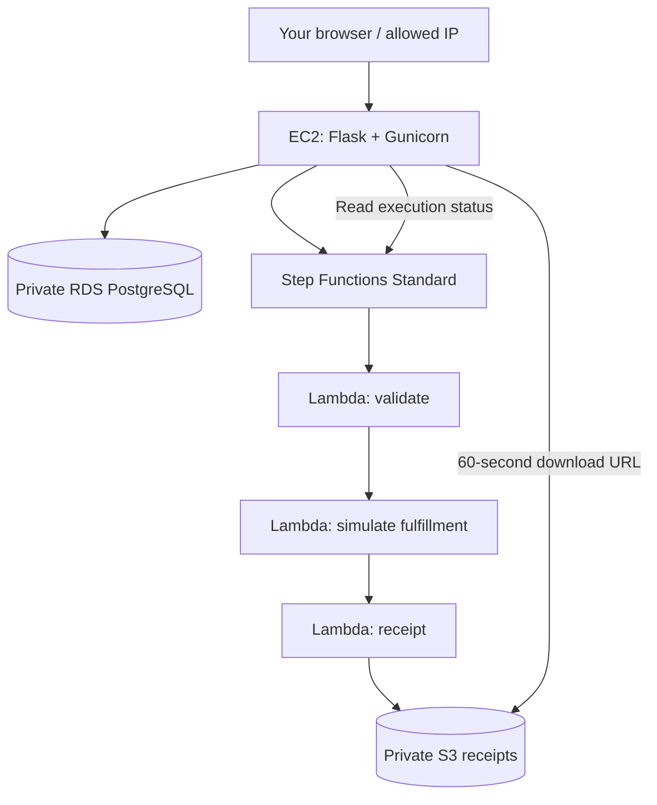

# Order Manager — guided Terraform lab

Build and explain a two-tier AWS application with asynchronous order processing. **Bootstrap, the network/EC2/RDS foundation, Milestone 4 serverless wiring, and the Milestone 5 deployment pipeline are implemented.** The application, Lambda handlers, tests, workflow definition, scoped GitHub roles, and deployment helpers are supplied.

Start locally; no AWS account is needed for milestone 1. This directory is a standalone repository starter, independent of the existing projects.

## Start here

```bash
docker compose up --build -d
```

Open **http://localhost:8000/orders**. Create an order, refresh after a few seconds, and download its receipt. Try the controlled failure checkbox too. The banner explicitly identifies **local simulation**; it makes no AWS calls.

```bash
docker compose logs app
docker compose down
```

Stopping containers preserves the local PostgreSQL volume. Use `docker compose down --volumes` only when deliberately resetting this lab's local data.

## Architecture



Flask and PostgreSQL are the two tiers. Workers run outside the VPC and never connect to the database. No NAT gateway is needed. The initial AWS app uses HTTP port 8000 restricted to your current public IPv4 /32; it is not a public authenticated service.

## Milestones

| Step | What you build | Completion checkpoint |
| --- | --- | --- |
| [1. Local app](docs/01-local.md) | Understand the app and simulator | Success and failure flows work locally |
| [2. Bootstrap](docs/02-bootstrap.md) | State, artifact storage, GitHub OIDC | State migrated; roles scoped to your repo |
| [3. Two tiers](docs/03-two-tier.md) | Network, EC2, private RDS | EC2 reaches DB; external users cannot |
| [4. Serverless](docs/04-serverless.md) | Lambda workers and Step Functions | AWS generates a receipt and records status |
| [5. GitHub deployment](docs/05-github.md) | Reviewed plans and versioned releases | GitHub deploys and smoke tests pass |
| [6. Operations and publishing](docs/06-operations.md) | Drift, failure diagnosis, cleanup, HTTPS extension | Teardown verified; publishing design understood |

Each guide includes exercises, commands, expected outcomes, hints, and interview prompts. AWS applies and GitHub workflow runs remain deliberate learner checkpoints. See each milestone guide for the implemented scope and next command.

## Layout

```text
app/                    Flask pages, PostgreSQL models, workflow adapters
orderlib/               Shared validation and receipt rules
workers/                Three Lambda handlers
tests/                  App, worker, AWS-adapter, deployment-helper tests
infra/bootstrap/        State/artifact/OIDC exercises
infra/dev/              Application infrastructure exercises and ASL template
scripts/                Packaging, reviewed deployment, smoke tests, material checks
.github/workflows/      Credential-free checks and manually gated plan/apply
docs/                   Six milestone guides and interface contracts
```

See [interface contracts](docs/contracts.md) for environment variables, routes, Terraform outputs, and permissions.

## Local checks

Install Python 3.12–3.14, uv, and Terraform 1.10 or newer. CI uses Python 3.13 and Terraform 1.16.1.

```bash
uv sync --frozen --extra dev
uv run pytest -q
uv run python scripts/check_materials.py
terraform fmt -check -recursive infra
```

Unit tests use isolated SQLite databases by default. CI runs the same app tests against a disposable PostgreSQL database. Never point `TEST_DATABASE_URL` at a database you want to keep: test fixtures recreate the orders table.

Verified during setup: 21 tests passed with SQLite and PostgreSQL, the Compose app passed live success/failure receipt smoke checks, both Terraform starters passed backend-free validation, and lesson links/YAML/HCL formatting were checked. AWS deployment and GitHub workflow execution require completing the exercises and have not been run.

## Working boundaries

- Region: `us-east-2`; environment: `dev`; demo data only.
- EC2, RDS, public IPv4, storage, and later ALB incur charges. No free-tier promise is made. Review regional pricing before each AWS milestone.
- GitHub deployment remains disabled until you explicitly set `LAB_READY=true`.
- Publishing to a new GitHub repository is a learner checkpoint; no remote repository or domain is assumed.
- Retain bootstrap state infrastructure when tearing down the application.
- This teaches a single-instance application, not highly available production infrastructure.
